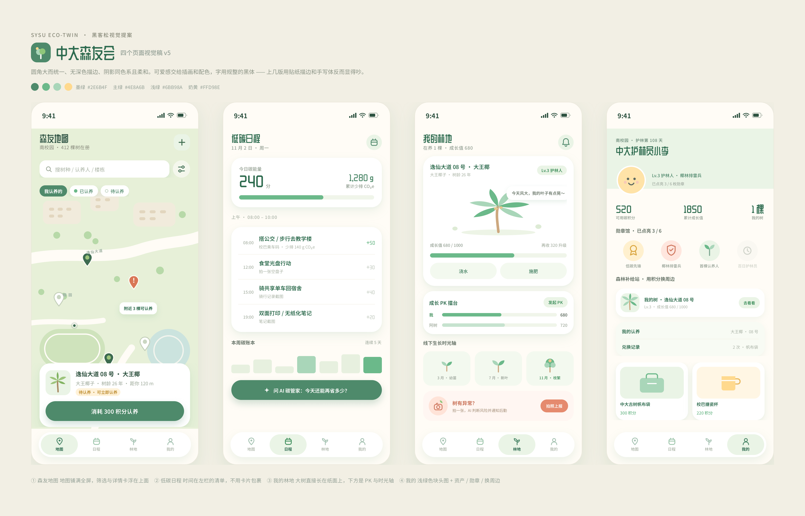

# SYSU Eco-Twin · 中大森友会

> A campus tree adoption and low-carbon co-governance platform powered by multimodal AI.
> Theme: environmental protection · Entry for the Elite Cup (菁英杯).

SYSU Eco-Twin connects **daily low-carbon behaviour** with **real trees on campus**. Commuting, clean-plate meals and cycling are verified by AI and converted into carbon points (碳积分). Points are spent to adopt a real tree on campus; owners can water and fertilise it, log its growth with offline photos, report pest or falling-branch hazards, join growth PK battles and redeem campus merchandise.

**Current version: 1.0** — all four pages are implemented with mock data and a local AI simulator.

---

## Pages

| Page | Route | Highlights |
| --- | --- | --- |
| **Tree Map** | `/pages/map/map` | Full-bleed campus map; pins coloured by state (available / adopted / hazard); floating search bar and filters; tap a pin to see details and adopt for 300 points |
| **Low-carbon Schedule** | `/pages/task/task` | Today's carbon energy and lifetime CO₂e saved; a task chain at 08:00 / 12:00 / 15:00 / 19:00; upload proof, AI verifies it and returns carbon saved plus a playful comment; weekly carbon ledger; AI schedule assistant |
| **My Grove** | `/pages/tree/tree` | Growth stage for the adopted tree (water / fertilise); growth PK arena; offline growth timeline (sprout → new leaf → lush); a photo report of pests or falling fronds generates a maintenance ticket `SYSU-xxxx` |
| **Me** | `/pages/honor/honor` | Assets (points / growth / adopted trees); badge wall; my tree and redemption history; eco store with redemption codes |

The bottom navigation is a custom floating tab bar (`components/app-tabbar.uvue`).

## Design system

Cream-white background with soft forest-green accents. No dark outlines; shadows are same-hue, large-blur and low-opacity.

| Token | Value |
| --- | --- |
| Background / card | `#FFFCF6` / `#FFFFFF` |
| Deep green (titles) | `#2E6B4F` |
| Primary green (buttons) | `#4E8A6B` |
| Progress bar | `#6BB98A` |
| Soft surfaces | `#EAF4E6` / `#F3F9EF` |
| Map / lawn | `#E7F0D8` / `#CFE3BC` |
| Warning (coral) | `#E07A5F` on `#FFF6F2` |
| Secondary text | `#9AA394` / `#B4BCAF` |
| Typeface | **HarmonyOS Sans SC** (Regular / Bold bundled, free for commercial use) |

All icons and illustrations are generated inside the repo (`static/ui`, `static/illus`) — no third-party icon library.

## AI capabilities

1. **Proof verification** — a photo or screenshot (bus QR code, cycling record, clean plate, paperless notes) is checked by a vision model, which estimates the carbon saved and writes a comment.
2. **Tree safety inspector** — detects pest type and falling-object risk (high / medium / normal) and produces a structured maintenance ticket with a reward.
3. **Schedule carbon assistant** — suggests how much more carbon can be saved today.

In 1.0 all three are **locally simulated** in `common/ai.uts` (with a 1.2–1.6s delay and rule-based output). The signatures mirror a real vision-LLM call, so switching to a real model only touches that single file.

## Tech stack

- **uni-app x** (`.uvue` + UTS, **vapor render mode**), verified on HBuilderX 5.34
- State: a single `reactive` store in `common/store.uts`; pages only read, all writes go through functions
- Data: five core objects — User / Tree / TreeLog / CarbonTask / Souvenir (`common/model.uts`)
- Map: hand-drawn view composition with percentage-based pin coordinates — no map SDK or API key required
- Font: `uni.loadFontFace` with the bundled HarmonyOS Sans SC (Regular and Bold registered as two families)

## Run it

1. Open the folder with HBuilderX 5.34+ (generate a DCloud `appid` when prompted)
2. Run to **Web** for a quick interactive preview, or to **Android** after signing in and connecting a device
3. The first Android run downloads the standard base (~300 MB, once only)
4. The font is bundled, so it works offline; the console prints `font ok HYSans` / `font ok HYSansBold`

> The uni-app x vapor runtime ships **arm64-v8a only** — x86 emulators (MuMu, LDPlayer, x86_64 AVD) will crash or show a blank screen. Use a real device.

## Team split

| Member | Module | Deliverables |
| --- | --- | --- |
| Captain | Architecture, 1.0 foundation, merge and deploy | Repo and routing skeleton, shared state and API layer, packaging, demo hosting |
| Member A | Tree map and adoption (page 1) | Map rendering, pins, adoption flow, on-campus photo collection |
| Member B | Low-carbon schedule and AI verification (page 2) | Task list, proof upload, AI integration, weekly ledger, demo video |
| Member C | My grove (page 3) | Watering and fertilising, PK arena, growth timeline, hazard reports, poster |
| Member D | Me (page 4) | Profile and assets, badges, eco store redemption, pitch deck |

See [`docs/团队开发手册与分工指南.docx`](docs/团队开发手册与分工指南.docx) for the full specification and [`docs/1.0实现说明.md`](docs/1.0实现说明.md) for the code structure and data model.

## Roadmap

- [x] Visual spec, data model, five-person split
- [x] 1.0 skeleton (routing / store / AI layer / custom navigation)
- [x] All four pages with complete UI and interaction loops
- [x] Bundled HarmonyOS Sans SC
- [ ] Real multimodal AI integration (single-file swap)
- [ ] Replace placeholder illustrations with real campus photos
- [ ] Integration test, packaging and deployment
