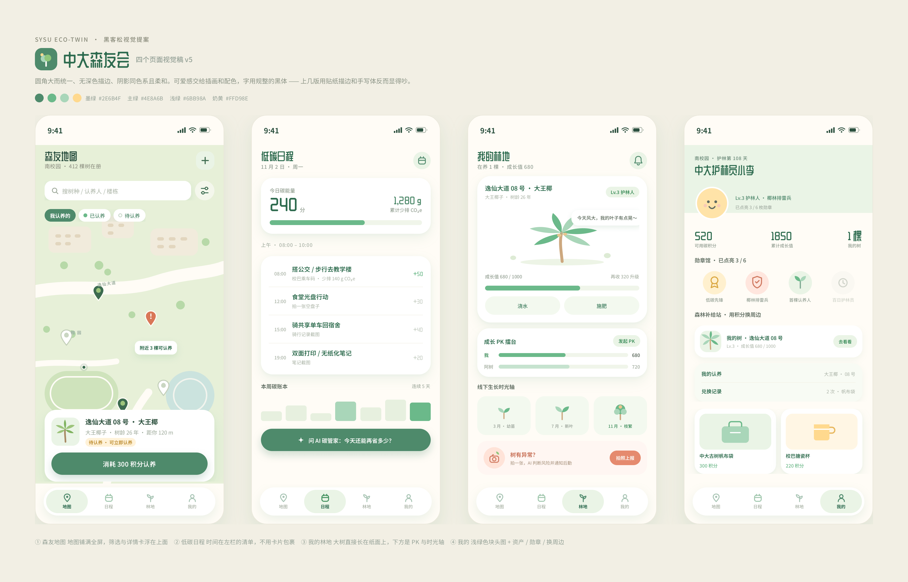

# 中大森友会 · SYSU Eco-Twin

> 基于多模态 AI 的校园树木认养与低碳共治平台
> 环保主题 · 菁英杯参赛作品

把「日程减碳」和「校园真实树木」绑在一起：日常通勤、光盘、骑行等低碳行为由 AI 核验后换成碳积分，积分用来认养中大校园里的真实树木，认养后可以浇水养大、线下打卡记录生长、上报虫害隐患，并参与成长 PK 与积分换周边。

---

## 一、四个核心页面

| 页面 | 路由 | 核心功能 |
| --- | --- | --- |
| **森友地图** | `/pages/map` | 校园地图全屏铺满，树木点位按状态区分（待认养 / 已认养 / 隐患预警）；地图左上角内嵌「我认养的 / 已认养 / 待认养」筛选；点击点位弹出树木详情卡，未认养可直接消耗积分认养 |
| **低碳日程** | `/pages/task` | 今日碳能量与累计减碳概览；按时间（08:00 / 12:00 / 15:00 / 19:00）排列的日程任务清单；拍照或截图上传后由 AI 核验，减碳量直接写进任务副标题；本周 7 天碳账本 |
| **我的林地** | `/pages/tree` | 认养树木的养成主舞台（浇水 / 施肥提成长值）；**成长 PK 擂台**；生长时光轴（线下拍照记录幼苗→新叶→枝繁）；虫害与坠叶隐患拍照上报，AI 判风险并生成后勤工单 |
| **我的** | `/pages/mine` | 个人信息与资产（碳积分 / 成长值 / 认养数）；勋章馆；我的树与兑换记录；森林补给站（积分兑换校园纪念品） |

## 二、视觉设计

**设计基调**：奶油白底 + 森绿柔光配色。不用深色描边，阴影一律同色系柔光；可爱感由插画和配色承担，文字保持规整。

| 项 | 值 |
| --- | --- |
| 底色 / 卡片 | `#FFFCF6` / `#FFFFFF` |
| 墨绿（标题） | `#2E6B4F` |
| 主绿（按钮） | `#4E8A6B` |
| 浅绿（进度、点缀） | `#6BB98A` |
| 奶黄（积分、勋章） | `#FFD98E` |
| 珊瑚（隐患预警） | `#C96A55` |
| 次级文字 | `#A8B2A6` / `#94A096` |
| 字体 | 标题与数字：站酷庆科黄油体；正文：思源黑体 / Noto Sans SC |
| 圆角 | 卡片 20–24，大卡 28，标签全圆角 |
| 阴影 | 同色系绿调、大模糊低透明度，不使用硬边偏移 |

## 三、AI 能力

1. **多模态凭证核验**：拍照 / 截图上传（乘车码、骑行记录、光盘照片、无纸化笔记），视觉大模型判断是否真实完成，并计算减碳量（g CO₂e）。
2. **AI 树灵**：每棵树按树种与位置拥有独立性格，浇水互动时可对话。
3. **AI 树木巡检医生**：识别病虫害类型与高空坠物风险等级，自动生成结构化的《校园绿化安全隐患反馈工单》（含坐标、风险描述、处理建议）并推送后勤。

## 四、技术栈（规划）

- 前端：uni-app 或 Vite + Vue3，一套代码同时产出 App 安装包与在线体验链接
- 状态：全局 store 统一管理用户、积分、成长值、树木与任务数据
- AI：视觉大模型（多模态）接口封装为统一 `aiService`
- 数据：5 个核心对象 —— User / Tree / TreeLog / CarbonTask / Souvenir

## 五、团队分工（五人均摊）

| 成员 | 负责模块 | 主要交付 |
| --- | --- | --- |
| 队长 | 总架构统筹 + 1.0 基建 + 合并部署验收 | 仓库与路由骨架、全局状态与接口封装、打包部署、答辩控场 |
| 队员 A | 模块一：森友地图与认养（页面 1） | 地图渲染、树木点位、认养闭环、校园实景数据采集 |
| 队员 B | 模块二：低碳日程与 AI 核验（页面 2） | 任务清单、凭证上传、AI 算碳对接、本周碳账本、演示视频录制 |
| 队员 C | 模块三：我的林地（页面 3） | 浇水施肥养成、成长 PK 擂台、生长时光轴、隐患上报、比赛海报 |
| 队员 D | 模块四：我的（页面 4） | 个人中心与资产、勋章馆、森林补给站兑换、资产数据对接、答辩 PPT |

详细的功能架构、数据规范、时间节点与答辩要点见 [`docs/团队开发手册与分工指南.docx`](docs/团队开发手册与分工指南.docx)。

## 六、开发进度

- [x] 四页面视觉稿与设计规范
- [x] 功能架构、数据模型与五人分工
- [ ] 1.0 基础骨架（路由 / 全局 store / AI 调用封装）
- [ ] 四个功能模块并行开发
- [ ] 联调、打包与部署

## 七、参与贡献

1. 从 `master` 拉取最新代码，各自在独立功能文件夹内开发（A → `/pages/map`，B → `/pages/task`，C → `/pages/tree`，D → `/pages/mine`）
2. 提交 Pull Request 给队长验收合并
3. 互不修改他人模块文件，避免冲突
